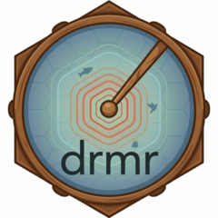

```{r, include = FALSE}
knitr::opts_chunk$set(
  collapse = TRUE,
  comment = "#>",
  fig.path = "man/figures/README-",
  out.width = "100%"
)
```

# drmr 

<!-- badges: start -->
[](https://lifecycle.r-lib.org/articles/stages.html#experimental)
<!-- badges: end -->

> **Warning:** If working on a MacOS (or Linux) machine, one should install
> `data.table` from source in order to use the package. Otherwise, one get
> `segmentation fault` errors which are hard to debug (and also not a `drmr`,
> but rather a `cmdstanr` issue). To install a package from source, one should
> use:
``` r
install.packages("<package>", type = "source")
```
> Moreover, we recommend installing
> [`instantiate`](https://github.com/wlandau/instantiate/) from GitHub instead
> of CRAN.


`drmr` (pronounced *drummer*) is an `R` package for fitting dynamic range models
to spatiotemporal data on species abundance. Dynamic range models are spatial
population models in which demographic rates (e.g., reproduction or mortality)
are influenced by the environment. Inference is carried out in a Bayesian
framework via Markov Chain Monte Carlo (MCMC) samples available in `Stan`.

For details, please see the vignettes listed below and [da Cunha Godoy et
al. 2026](https://ecoevorxiv.org/repository/view/12564/).

### Installation

`drmr` compiles its Stan models during installation, so it needs CmdStan.
Before you install `drmr`, install the `cmdstanr` package and CmdStan 2.38.0:

``` r
install.packages("cmdstanr",
                 repos = c("https://stan-dev.r-universe.dev",
                           getOption("repos")))
cmdstanr::install_cmdstan(version = "2.38.0")
```

Then install `drmr` from your copy of the package. Replace `path/to/drmr` with
the path to the package folder or `.tar.gz` file:

``` r
remotes::install_local("path/to/drmr")
```

### Vignettes

* Get started
* [Theoretical background](https://ecoevorxiv.org/repository/view/12564/)
* Model parameters and priors
* Algorithms
* Initializing densities
* Parameterization of the density functions
* Advanced features
